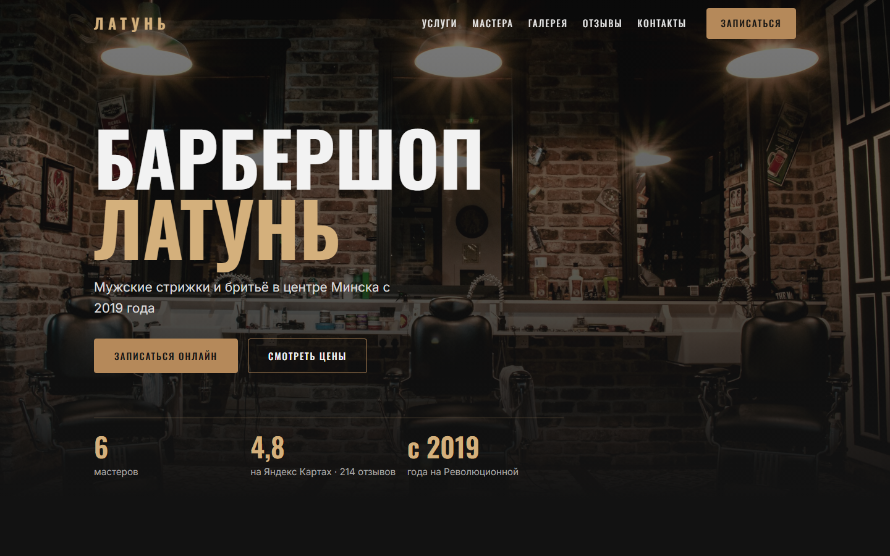

# Барбершоп «Латунь» — лендинг

Одностраничный адаптивный сайт для барбершопа «Латунь» в Минске (ул. Революционная, 17; бизнес вымышленный, демо для портфолио).
Тёмная тема, латунный акцент, крупная типографика.

**Демо:** _ссылка появится после деплоя_



## Стек

- HTML5 (семантическая разметка)
- CSS3 (переменные, Flexbox, Grid, mobile-first)
- Ванильный JavaScript, без фреймворков, библиотек и сборщиков
- Шрифты Google Fonts: Oswald + Inter
- Фото: Unsplash, карта: OpenStreetMap

## Что умеет

- Sticky-шапка, которая получает фон и тень при прокрутке
- Бургер-меню на мобильных: плавно открывается, закрывается по клику на ссылку и по Esc
- Плавный скролл к якорям с учётом высоты шапки
- Появление секций при скролле через IntersectionObserver
- Галерея с лайтбоксом: стрелки, клавиши ←/→, закрытие по Esc и клику вне фото
- Слайдер отзывов: стрелки, точки, свайп, автопрокрутка с паузой при наведении
- Форма записи: маска телефона `+375 (XX) XXX-XX-XX`, валидация, сообщение об успехе (данные выводятся в консоль)
- Кнопка «Наверх»
- Учитывает `prefers-reduced-motion`: анимации и автопрокрутка отключаются
- Доступность: alt у фото, aria-label у кнопок-иконок, видимый фокус, ссылка «Перейти к содержимому»
- Мобильное меню: пока оно открыто, Tab не уходит на страницу под ним
- SEO: title, description, Open Graph, Twitter Card, SVG-favicon

## Структура

```
index.html         — разметка всех секций
privacy.html       — политика конфиденциальности (демо-текст)
css/styles.css     — стили (брейкпоинты 480 / 768 / 1024 / 1280)
js/script.js       — меню, скролл, лайтбокс, слайдер, форма
img/favicon.svg    — иконка сайта
img/screenshot.png — скриншот для README
```

## Как запустить

Просто откройте `index.html` в браузере двойным щелчком.

Или через локальный сервер (удобнее для проверки в DevTools):

```bash
npx serve .
```

Для фото, шрифтов и карты нужен интернет.
